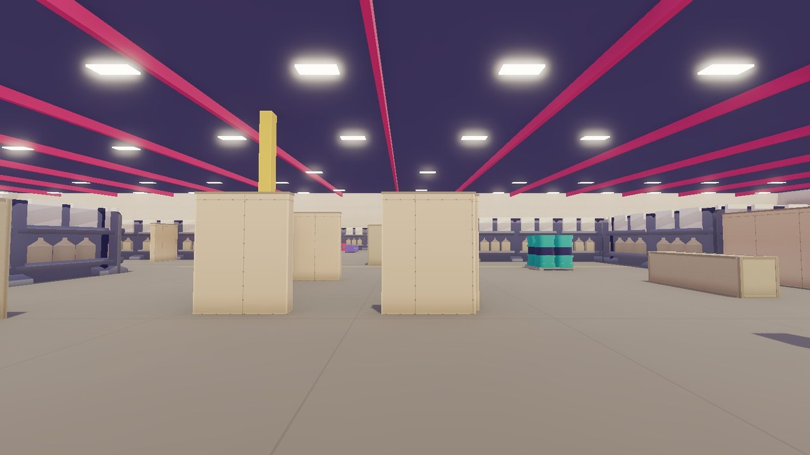
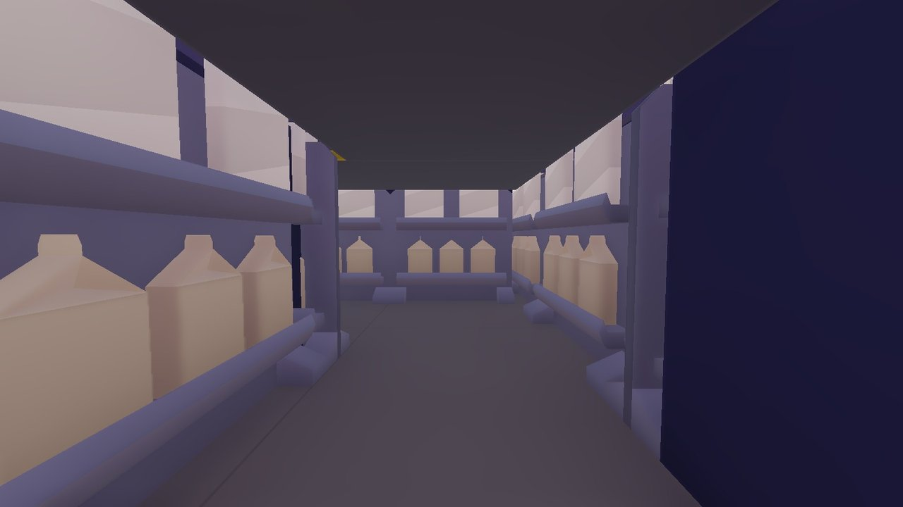

# Maps

Every field in Airsoft is built like a real airsoft site: cover to move between, choke points, flanking routes, long
and short sightlines, and a spawn and a dead zone at each end. Pick a map on the **Match** screen from its picture
card.

<!-- wiki:maps -->

**Team sizes** are the players a side the map offers. [Skirmish](Modes#skirmish-and-custom) plays the usual size;
under Custom rules you pick any size the map offers. Fields are greybox for now: plain blocks and colours, with the
finished models coming later ([Roadmap](Roadmap)).

## Depot

**An indoor airsoft hall**, 108 by 72 metres under one roof, in 5v5 or 6v6. Alpha starts at the east end and Beta in
the west in Elimination, and the teams swap ends at half time.

- **Three lanes** wind from end to end between plywood rooms and racking you can't enter: the **Shoot House** and
  the **Lounge** to the north, the open **Chrono hall** in the middle, the **Huts** and the **Box yard** to the
  south. No lane runs straight; each bends round the dead space.
- **Links** join the lanes: open cuts and galleries, two tight alleys, and two **tunnels**, one in each half. The
  tunnels are unlit and bend twice: dark, but never pitch black.
- **The roof:** a dark steel ceiling on red trusses, with rows of lamps. A BB fired up stops at the ceiling.
- **Long sight lines** down the Chrono hall and the yards: bots on Depot see 55 metres, further than on other fields.
- **The Box** sits in the Box yard: a roofed container you can fight inside, and container rows with ports guard
  B site.
- **Not mirrored:** the halves differ, but they're balanced. Both teams reach the Chrono hall together; Beta reaches
  the Lounge first and Alpha the Box yard, by about the same margin.
- **Spawn rooms** open by two crate chicanes each, so nobody sees into a spawn from the floor outside it.
- **Noisy props:** running into a container, a steel drum, a plastic barrel, a rack or a crate stack makes a noise
  bots hear, and a BB rings off the steel ([Movement](Movement#paces)).
- **Doors:** some of the plywood rooms and huts have green [doors](#doors), some starting open and some shut.
- **Attack / Defend** puts two flagpoles at the defenders' end, **A** on A site and **B** on B site; the attackers
  raise either ([Modes](Modes#attack--defend)).
- Fields are greybox for now: plain blocks in the site's colours, with props and the final models coming later.

### Areas

The minimap names the area you stand in. Depot's areas:

<!-- wiki:areas depot -->

### Doors

Depot has 15 hinged doors, painted green so they stand out from the plywood. Every round starts with the same doors
open and the same ones shut. Press **Open / shut door** (U, [Controls](Controls)) within reach of one to open or shut
it; a line under the crosshair tells you which.

- **A shut door is solid.** It stops BBs, bombs, sight and bodies, so it hides who is behind it.
- **Doors are loud.** Opening or shutting one creaks and bangs, and the other team hears it out to <!-- wiki:config door_config.heard -->
  metres, even through walls. It shows on their minimap as a sound.
- **One swing at a time.** A door takes a moment to swing, and it won't shut on someone standing in the doorway.
- **Bots use them too.** A bot opens a shut door on its way, noise and all. Someone walking off after a hit opens one
  in their path.

## Woodland

**A wide, rolling wood, played at night**, in 5v5 or 6v6. Its ground slopes up to the Knoll and its log fort, with a
rise to the west and a dry ravine along the creek, and three lanes: through the pines, across the meadow and down the
creek past the cabin. Every slope walks; none needs a jump.

- **Night:** a low moon, stars and haze, with fires and lanterns lighting pools of ground round them. Fires flicker,
  and fireflies hang by the logs and the water. Fit a [weapon torch](Parts-and-Power#lights) to see further, and load
  [glowing BBs](Loadout#customise) to follow your shots.
- **Seeing in the dark:** bots see you from about 40 m in the light of a fire, a lantern or a torch beam, 25 m in the
  open under the moon, 15 m indoors and only 10 m under the trees ([Bots](Bots#at-night)).
- **Bushes** hide you and stop BBs. You walk straight through them, but nobody sees you through more than about half
  a metre of leaves; a BB that pushes 0.6 m into a bush stops there, and one that clips an edge flies on, slower and
  thrown off its line. A BB in the leaves rustles and throws a green puff. The minimap marks every bush.
- **The pines** each have a crown over your head, for looks only: you see and shoot under it. A forest and treelines
  stand beyond the fence. From Medium detail there is grass in the meadow, wet puddles and mud, leaves, fallen
  branches and moss.
- Footsteps sound like grass or leaf litter, and a BB that hits the ground puffs like earth and never bounces. Owls
  and creaking branches call from the wood.
- **Attack / Defend** puts a flagpole at the defenders' flag spot ([Modes](Modes#attack--defend)).

### Areas

Woodland's areas:

<!-- wiki:areas woodland -->

## Range

**The practice range:** lanes of steel plates, figures and moving targets, with no bots and no score, in its own lot
beside Depot's yard and under the same sky. It sits on the Match screen beside the fields, with Practice as its only
mode. Every field hosts Practice too, with targets where the other team would play. Everything about both is on
[Practice Range](Practice-Range).
