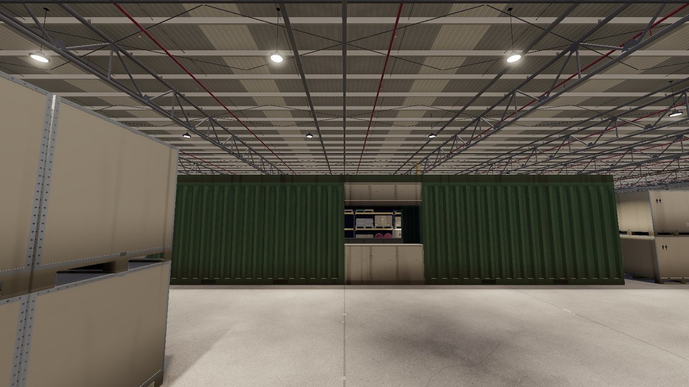
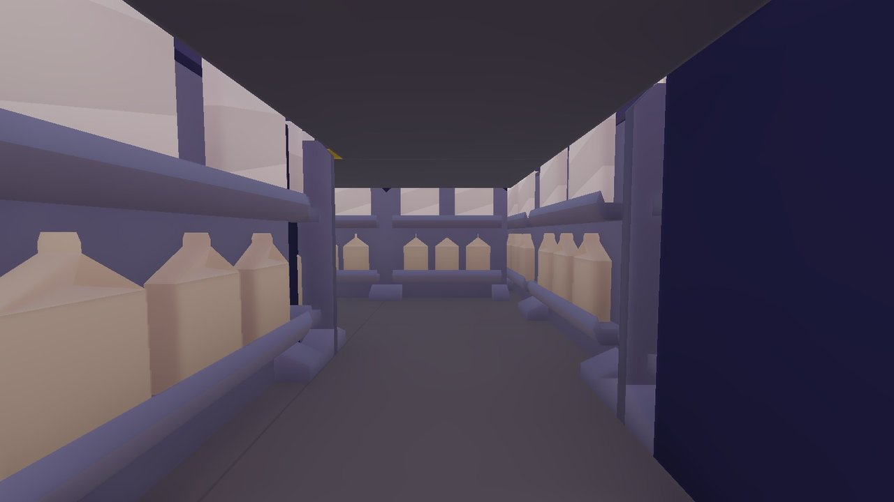

# Maps

Every field in Airsoft is built like a real airsoft site: cover to move between, choke points, flanking routes, long
and short sightlines, and a spawn and a dead zone at each end. Pick a map on the **Match** page from the
Fields list: each one shows a small picture taken at a player's eye height and a line about it.

<!-- wiki:maps -->

**Team sizes** are the players a side the map offers. [Skirmish](Modes#skirmish-and-custom) plays the usual size,
6v6 on every field; under Custom rules you pick any size the map offers, 5v5 to 8v8. Fewer players make a slower,
more careful match, more make a faster, busier one. Fields are dressed with free CC0 props over plain blocks and
colours, with the finished models coming later ([Roadmap](Roadmap)).

## Depot

**An indoor airsoft hall**, 108 by 72 metres under one roof, in 6v6 (5v5 to 8v8 under Custom). Alpha starts at the east
end and Beta in the west in Elimination, and the teams swap ends at half time.

- **Three lanes** wind from end to end between plywood rooms and racking you can't enter: the **Shoot House** and
  the dim **Lounge** to the north, the open **Chrono hall** in the middle, the **Huts** and the **Box yard** to the
  south. No lane runs straight; each bends round the dead space.
- **Links** join the lanes: open cuts and galleries, two tight alleys, and two **tunnels**, one in each half. The
  tunnels are unlit and bend twice: dark, but never pitch black.
- **The building:** blockwork walls under cladding, with crimson steel columns, roller shutters and fire exits;
  steel pillars with hazard bands; scaffold walls hung with camouflage netting; a polished concrete floor.
- **The roof:** crimson trusses, purlins and rooflights, a sprinkler main and cable trays, with rows of high-bay lamps
  hanging on cables. A BB fired up stops at the roof.
- **It sounds like a big empty hall:** a quiet hum of the building, with the odd creak from the roof.
- **No full auto indoors:** as at a real indoor site, every replica that can fire full auto starts each round on
  single shots here, bots' too. Press **B** to switch to auto during the round if you want it. Bots switch only now
  and then, at someone out in the open down one of Depot's long sight lines.
- **Long sight lines** down the Chrono hall and the yards: bots on Depot see 55 metres, further than on other fields.
- **The Box** sits in the Box yard: a roofed container you can fight inside, and container rows with ports guard
  B site.
- **Not mirrored:** the halves differ, but they're balanced. Both teams reach the Chrono hall together; Beta reaches
  the Lounge first and Alpha the Box yard, by about the same margin.
- **Spawn rooms** open by two crate chicanes each, so nobody sees into a spawn from the floor outside it.
- **Noisy props:** running into a container, a steel drum, a plastic barrel, a rack or a crate stack makes a noise
  bots hear, and a BB rings off the steel ([Movement](Movement#paces)).
- **Doors:** some of the plywood rooms and huts have wooden [doors](#doors), some starting open and some shut.
- **Attack / Defend** puts two flagpoles at the defenders' end, **A** on A site and **B** on B site; the attackers
  raise either ([Modes](Modes#attack--defend)).
- **The look:** clean painted surfaces in soft, stylised light, with crimson, violet, yellow, teal, green and cream
  spread over the hall so the team colours stay the loudest.
- **Props:** the hall's racking, drums, barrels, sofa, desks and lockers are the game's own models: navy and yellow
  pallet racking stocked three different ways (cartons, sacks, wrapped loads, drums, some slots empty) and mixed along
  every rack, violet steel drums stacked two
  high, nine stacks to a pallet, teal plastic barrels in pairs, a worn four-seat sofa in the Lounge, office desks with
  their drawers and modesty panels, and a bank of steel lockers in front of the Offices door. Each fills the space
  its block did, so what you see is what stops a BB; a BB grazing past a round drum or barrel flies on by its curve
  instead of stopping at a square corner. Steel drums ring when hit and plastic barrels tick. The plywood walls (birch sheets,
  battens and screws), the wooden crates on their pallets and the corrugated shipping containers, each in its own
  paint, are the game's own models too, made after photos of the real things, and fill their blocks the same way.

### Areas

The minimap names the area you stand in. Depot's areas:

<!-- wiki:areas depot -->

### Doors

Depot has 15 hinged doors and Woodland's huts 8: two-panel timber doors in a frame, darker than the plywood so they
stand out from it. Every round starts with the same doors
open and the same ones shut. Press **Open / shut door** (G, [Controls](Controls)) within reach of one to open or shut
it; a line under the crosshair tells you which.

- **A shut door is solid.** It stops BBs, bombs, sight and bodies, so it hides who is behind it.
- **Doors are loud.** Opening or shutting one creaks and bangs, and the other team hears it out to <!-- wiki:config door_config.heard -->
  metres, even through walls. It shows on their minimap as a sound.
- **One swing at a time.** A door takes a moment to swing, and it won't shut on someone standing in the doorway.
- **Bots use them too.** A bot opens a shut door on its way, noise and all. Someone walking off after a hit opens one
  in their path.

## Woodland

**A big open wood, 176 by 120 m, by day or by night**, in 6v6 (5v5 to 8v8 under Custom). A dry stream runs down the
middle, and three lanes cross it: the **north** over the Ridge, the North bridge and the Tower to the Fort; the
**middle** past the Cabin and the Woodpile to the Clearing, over the Ford to Hut row; the **south** along the gravel
road, round the Truck bend, over the Culvert to the Log stacks and the Sawmill. Attackers start in the west camp and
defenders in the east camp.

- **The stream:** its bed is 1.7 m under its banks, which are too steep to climb. Cross on the North bridge or the road,
  or walk in and out at the Ford and the gentle slides. Down in the bed you're out of sight of the wood above.
- **The look:** the game's soft, stylised light over a bright green wood: lime-lit crowns, pine-green spruces, a
  meadow floor, and the violet pickup wreck carrying the colour, with nothing near a team's blue or orange.
- **Long views, few walls:** the Ridge looks 86 m down onto the Fort; elsewhere a lane's longest line is under 80 m.
  Cover is fallen logs, wind-thrown trees torn out by their roots, woodpiles, stacks of tractor tyres, wooden crates,
  the violet pickup wreck and the trunks of the trees themselves, free CC0 models and the game's own; each stops a BB
  about where you see it, a round trunk by its bark (its roots fill its back corners). The woodpiles are 1.8 m tall,
  so they hide you standing; the camps' gate screens stand 2.8 m. The
  thickets of spruce at the edges and between
  the lanes can't be entered or seen through.
- **Ferns** grow knee to hip high in eight beds where you'd want to hide, and leafy **bushes** stand taller. Nobody sees you
  through more than about half a metre of leaves, so crouch in a fern bed to vanish; you can walk through ferns and
  bushes, but they slow you and a run through them rustles loudly ([Movement](Movement)), and a BB that pushes 0.6 m
  into leaves stops there. The minimap marks them. Grass never hides you.
- **Three crouch tunnels,** 1.4 m high: the Crawl box, a hollow log through the Berm between the Ridge and the
  Clearing; the Badger run, another hollow log through the Knoll between the middle and the south; and the Culvert,
  the concrete-lined stream bed under the road. Crouch to go through; inside you stay down until you're out, and bots
  crouch through too. The stream bed under the North bridge is crouch height as well, a fourth low way along the bed.
- **The huts:** the Cabin, the two huts of Hut row and the Box on A site have windows and two wooden [doors](#doors)
  each. The door facing the other team's end starts each round shut and the one facing your own end open, so a hut
  is walked into from its own side and opened, loudly, from the other. The Tower is a platform 3.4 m up a stair, the
  Sawmill an open shed with a saw bench, rounds and a stack of sawn boards.
- **Night** is the Time of day setting's (day by default): a low moon, stars and haze, with fires and lanterns at the
  camps, the huts, the Clearing, the Fort, the Sawmill, the Truck bend and the North bridge: campfires in stone rings,
  and hurricane lanterns hung from a roof, a post or a hooked pole, which stand cold by day. Bots see you from about
  40 m in their light, 25 m under the moon and 10 m under the trees ([Bots](Bots#at-night)); by day they see 60 m.
  At night, fit a [weapon torch](Parts-and-Power#lights) and load [glowing BBs](Loadout#customise).
- Footsteps sound like grass, leaf litter, gravel or boards, and a BB that hits the ground puffs like earth. By day
  and by night the wood sounds like a real one; owls and creaking branches call from it.
- **Attack / Defend** puts flag **A** in the Fort and flag **B** at the Sawmill ([Modes](Modes#attack--defend)); in
  Elimination's overtime the flag stands in the Clearing.

### Areas

Woodland's areas:

<!-- wiki:areas woodland -->

## Range

**The practice range:** lanes of steel plates, figures and moving targets, with no bots and no score, in its own lot
beside Depot's yard and under the same sky. It sits on the Match screen beside the fields, with Practice as its only
mode. Every field hosts Practice too, with targets where the other team would play. Everything about both is on
[Practice Range](Practice-Range).
