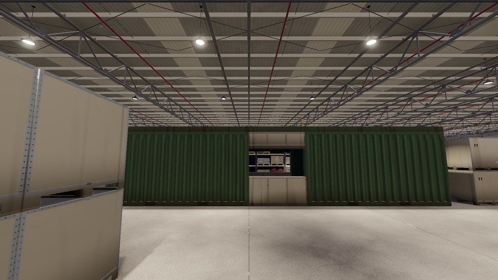
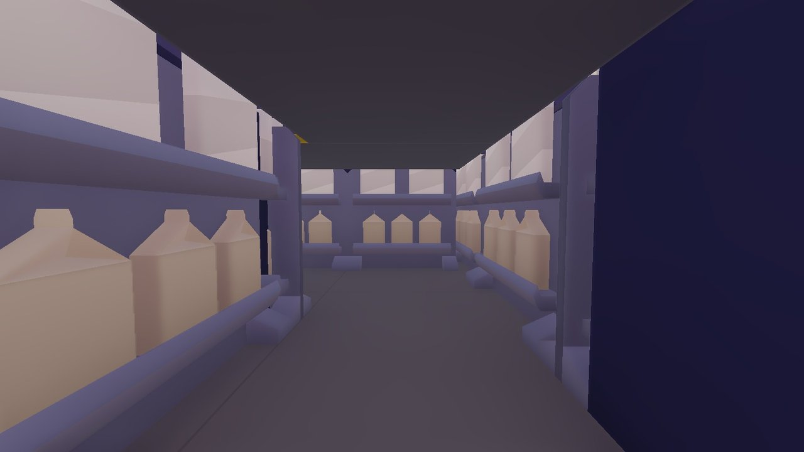

# Maps

Every field in Airsoft is built like a real airsoft site: cover to move between, choke points, flanking routes, long
and short sightlines, and a spawn and a dead zone at each end. Pick a map on the **Match** page from the
Fields list: each one shows a small picture taken at a player's eye height and a line about it.

<!-- wiki:maps -->

**Team sizes** are the players a side the map offers. [Skirmish](Modes#skirmish-and-custom) plays the usual size,
6v6 on every field; under Custom rules you pick any size the map offers, 5v5 to 8v8. Fewer players make a slower,
more careful match, more make a faster, busier one. Fields are dressed with free CC0 props over plain blocks and
colours, with the finished models coming later ([Roadmap](Roadmap)).

## Depot

**An indoor airsoft hall**, 98 by 72 metres under one roof, in 6v6 (5v5 to 8v8 under Custom). Alpha starts at the east
end and Beta in the west in Elimination, and the teams swap ends at half time.

- **Three lanes** wind from end to end between plywood rooms and racking you can't enter: the **Shoot House** and
  the dim **Lounge** to the north, the open **Chrono hall** in the middle, the **Huts** and the **Box yard** to the
  south. No lane runs straight; each bends round the dead space. Bots take five routes through them: down each side's
  corridor, through each side's rooms (the Shoot House, the Lounge and the Offices; the Pens, the Huts and between the
  containers) and down the middle, so every room sees a fight.
- **Links** join the lanes: open cuts and galleries, a tight alley by B, and two **tunnels**, one in each half. The
  tunnels are unlit and bend twice: dark, but never pitch black.
- **The building:** blockwork walls under cladding, with galvanised steel columns, roller shutters and fire exits;
  steel pillars with hazard bands; scaffold walls hung with camouflage netting; a polished concrete floor. Pipework
  and cable baskets run along the walls high up, with valves and sprinkler drops; fire points and safety signs at
  eye height on the open walls, and a call point and extinguisher on each pillar.
- **The storage:** the racking you can't enter holds shrink-wrapped pallets, stacks of chemical tanks and drums, or
  a mesh parts cage stacked with shelves and boxes. Every stack is as solid as the next: you can't shoot through the
  gaps.
- **The roof:** galvanised steel trusses, purlins and rooflights under a pale grey liner, red sprinkler mains and cable
  trays, with rows of high-bay lamps hanging on cables. A BB fired up stops at the roof. The lamps are not all new:
  some burn dimmer and warmer, a few flicker now and then, and a couple are dead, the same ones every match.
- **It sounds like a big empty hall:** a quiet hum of the building, with the odd creak from the roof.
- **No full auto indoors:** as at a real indoor site, every replica that can fire full auto starts each round on
  3-round bursts here (single shots if it has no burst), bots' too. Press **B** to switch to auto during the round if you want it. Bots switch only now
  and then, at someone out in the open down one of Depot's long sight lines.
- **Long sight lines** down the Chrono hall and the yards: bots on Depot see 55 metres, further than on other fields.
- **The Box** sits in the Box yard: a roofed container you can fight inside, and container rows with ports guard
  B site.
- **Not mirrored:** the halves differ, but they're balanced. Both teams reach the Chrono hall together; Beta reaches
  the Lounge first and Alpha the Box yard, by about the same margin.
- **Spawn rooms** open by two crate chicanes each, so nobody sees into a spawn from the floor outside it. Beta's (the
  west's) **Staging** opens straight onto Upper mid behind a rack of crates, with stairs north to the Yard and south
  to the Pens.
- **Noisy props:** running into a container, a steel drum, the steel lockers, a plastic barrel, a rack or a crate stack
  makes a noise bots hear, and a BB rings off the steel ([Movement](Movement#paces)).
- **Doors:** some of the plywood rooms and huts have wooden [doors](#doors), some starting open and some shut.
- **Attack / Defend** puts two flagpoles at the defenders' end, **A** on A site and **B** on B site; the attackers
  raise either ([Modes](Modes#attack--defend)). Each pole stands at the hall's end of its site, beside a crate stack,
  so the defenders have ground in front of it to hold: bots defending post at the Offices door, in Lower mid and at the
  end of the Containers, and the fight starts there, not on the pole. Plant The Bomb's two sites
  are round the same poles.
- **The look:** a real warehouse in daylight: concrete and plywood with their grain, weathered paint in muted
  crimson, violet, yellow, teal, green and cream, so the team colours stay the loudest. Walls, crates and containers
  are worn: grime at their feet, streaks down their sides, dust on top.
- **Props:** the hall's racking, drums, barrels, sofa, desks and lockers are the game's own models: navy and yellow
  pallet racking stocked three different ways (cartons, sacks, wrapped loads, drums, some slots empty) and mixed along
  every rack, violet steel drums stacked two
  high, nine stacks to a pallet, teal plastic barrels in pairs, a worn four-seat sofa in the Lounge, office desks with
  their drawers and modesty panels, and a bank of steel lockers in front of the Offices door. Each fills the space
  its block did, so what you see is what stops a BB; a BB grazing past a round drum or barrel flies on by its curve
  instead of stopping at a square corner. Steel drums ring when hit and plastic barrels tick. The plywood walls (birch sheets,
  battens and screws), the wooden crates on their pallets and the corrugated shipping containers, each in its own
  paint, are the game's own models too, made after photos of the real things, and fill their blocks the same way.

### Areas

The minimap names the area you stand in. Depot's areas:

<!-- wiki:areas depot -->

### Doors

Depot has 15 hinged doors and Woodland's huts 8: two-panel timber doors in a frame, darker than the plywood so they
stand out from it. Every round starts with the same doors
open and the same ones shut. Press **Open / shut door** (G, [Controls](Controls)) within reach of one to open or shut
it; a line under the crosshair tells you which (**OPEN DOOR [G]** or **CLOSE DOOR [G]**).

- **A shut door is solid.** It stops BBs, bombs, sight and bodies, so it hides who is behind it.
- **Doors are loud.** Opening or shutting one creaks and bangs, and the other team hears it out to <!-- wiki:config door_config.heard -->
  metres, even through walls. It shows on their minimap as a sound.
- **One swing at a time.** A door takes a moment to swing, and it won't shut on someone standing in the doorway.
- **Bots use them too.** A bot opens a shut door on its way, noise and all. Someone walking off after a hit opens one
  in their path.

## Woodland

**A big open wood, 176 by 120 m, by day or by night**, in 6v6 (5v5 to 8v8 under Custom). A shallow stream runs down the
middle, and six routes cross it: the **north** over the Ridge, the North bridge and the Tower to Fern hollow; the
**north edge** up the Pine slope, along the Ridge's far side and over the stream's north end; the **north middle**
along the Berm, over the stream north of the Clearing to the Hollow way; the **middle** past the Cabin and the Woodpile
to the Clearing, over the Ford to Hut row; the **south middle** across the Clearing's south side and over the stream
by the Knoll to Log stacks; and the **south** along the gravel road, round the Truck bend, over the Culvert to Log
stacks. Bots use all six. Attackers start in the west camp and defenders in the east camp.

- **The stream:** its bed is 1.7 m under its banks, which are too steep to climb. Cross on the North bridge or the road,
  or walk in and out at the Ford and the gentle slides. Down in the bed you're out of sight of the wood above. A level
  stream of shin-deep water runs along it: wading slows you to 60% of your pace and every stride splashes: a running
  splash carries about half as far again as a run on earth, and even a walk or a crouch splashes nearly as far as a
  run on earth. The Ford is a gravel bar only ankle
  deep, so you splash over it at full pace. Bots splash and slow the same way, and they take the bridge or the road
  where it isn't far out of their way. A BB that lands in the water splashes and sinks.
- **The look:** warm afternoon sun over a natural green wood: young, grown and old Scots pines with bare tan trunks
  under their crowns, broad, lumpy oaks, white birches in the Birch stand and Fern hollow, dark spruce thickets, and
  beyond the fence a far wood of spruce spires in uneven clumps and gaps. A grassy floor, the weathered violet pickup wreck and teal crates carry
  the colour, with nothing near a team's blue or orange. Every crown starts over head height. Up close the crowns,
  ferns and bushes are real sprays of leaves and needles that the sun shines through, on photo bark, and the timber,
  logs, earth and concrete of the huts, tower, bridge, palisade and tunnels show their grain.
- **Three lanes, three ranges:** no lane is shot from end to end. A hazel hedge on the Ridge's brow, fallen trees
  and a log stack at the North bridge's two heads, the Long road's double bend between two stands of spruce west of
  the Culvert, and two spruce thickets on the Ford's east bank break the long lines. Nothing stands on the road
  itself: its woodpiles and its one fallen tree are on the verges. The road is close work through the bend and a
  longer look from the Culvert up to Log stacks, the Clearing a mid-range fight, with a fallen tree in its
  middle, a stack of tyres at its west edge for the west team coming in, and the Ford and its ramp, 5 m wide, up
  to Hut row, and the north lane over the bridge is the long one.
- **Few walls:** cover is fallen logs, wind-thrown trees torn out by their roots, woodpiles, stacks of tractor tyres,
  wooden crates, the violet pickup wreck and the trunks of the trees themselves, and the camps and the field's edge are
  walled by a log palisade of sharpened stakes; each stops a BB about where you see it, a round trunk by its bark. The
  woodpiles, split logs of every shape and size stacked by hand, are 1.8 m tall, so they hide you standing; the camps' gate screens stand 2.8 m. The thickets of spruce at
  the edges and between the lanes can't be entered or seen through; like the bushes, they stop BBs and sight where
  their boughs are, narrowing as the spruces taper, so a shot past a thicket's end, or through the gap between two
  spruces' tops, at someone you can see flies on. A tree's trunk stops a BB where its bark is, thick at the foot and
  thinner as it rises. The west camp's front palisade stands 3.4 m, so nobody on the high ground looks over it.
- **Ferns** grow knee to hip high in eight beds where you'd want to hide, and leafy **bushes** stand taller. Only the
  thick of a plant counts, the fronds and leaf clusters you can see, never its wispy tips: nobody sees you through more
  than about half a metre of it, and a BB that pushes 0.6 m into it stops there. Crouch deep in a fern bed to vanish;
  at its edge or with your head over the fronds you can be seen, spotted and hit. You can walk through ferns and
  bushes, but they slow you and a run through them rustles loudly ([Movement](Movement)). The minimap marks them.
  Grass never hides you.
- **Three crouch tunnels,** 1.4 m high: the Crawl box, a hollow log through the Berm between the Ridge and the
  Clearing; the Badger run, another hollow log through the Knoll between the middle and the south; and the Culvert,
  the concrete-lined stream bed under the road. Crouch to go through; inside you stay down until you're out, and bots
  crouch through too. The stream bed under the North bridge is crouch height as well, a fourth low way along the bed.
- **The huts:** the Cabin, the two huts of Hut row and the Box in the Fort have windows and two wooden [doors](#doors)
  each. The door facing the other team's end starts each round shut and the one facing your own end open, so a hut
  is walked into from its own side and opened, loudly, from the other, under shake roofs. The Tower is a timber watch
  tower, its deck 3.4 m up a stair, walled in all round but the stair's head by waist-high board walls under a roof;
  the North bridge is a log bridge with closed slab sides; the Sawmill is an open timber shed under a corrugated roof,
  with a saw bench, rounds and a stack of sawn boards.
- **Night** is the Time of day setting's (day by default): a low moon, stars and haze, with fires and lanterns at the
  camps, the huts, the Clearing, both flags, the Fort, the Truck bend and the North bridge: campfires in stone rings,
  and hurricane lanterns hung from a roof, a post or a hooked pole, which stand cold by day. Bots see you from about
  40 m in their light, 25 m under the moon and 10 m under the trees ([Bots](Bots#at-night)); by day they see 60 m.
  At night, fit a [weapon torch](Parts-and-Power#lights) and load [glowing BBs](Loadout#customise).
- Footsteps sound like grass, leaf litter, gravel or boards, and a BB that hits the ground puffs like earth. By day
  and by night the wood sounds like a real one; owls and creaking branches call from it.
- **Attack / Defend** puts flag **A** in Fern hollow, under an oak beside a wind-thrown tree just west of the Fort,
  and flag **B** at Log stacks, in a pocket between three woodpiles just south of the road ([Modes](Modes#attack--defend)); Plant
  The Bomb's sites A and B are in the same places. Both stand well out from the defenders' camp, so the defenders
  have ground to hold in front of them: some meet the attack at the stream crossings, the Tower and Hut row, and the
  rest hold by the flags, with the walled Fort and the Sawmill's shed behind them. In Elimination's overtime the flag
  stands in the Clearing. The two flags stand far apart, so a flag here takes longer to raise than on Depot (the table
  at the top of this page), which gives the defenders at the other flag time to come across.

### Areas

Woodland's areas:

<!-- wiki:areas woodland -->

## Subway

**A closed metro station on two levels**, Morrin Street in the town of Copperhill, in 6v6 (5v5 to 8v8 under Custom).
One team starts in the ticket hall at the west end, the other down in the running tunnels at the east end.

- **The ticket hall and concourse** are one level: the closed ticket office, a shuttered kiosk and the old booking
  counter at the street end, benches along the walls, then the lifts, the gate line of paddle gates and the hole of
  the spiral stair, and the concourse with its cable drums beyond. Right behind the street team's start, a doorway in
  the west wall looks onto a stair and an escalator climbing to the street in daylight, shut off by a locked folding
  gate.
- **Four ways down** to the platforms, 8 m below: the escalators to the lower hall between the platform tunnels, an
  ordinary stair with a half landing, the spiral stair straight down to the south platform, and the two **lifts**.
  A lift has two stops, the hall and the platforms, and takes 4 seconds. Call it from its landing (**CALL LIFT [G]**), or step in and
  press the stop you want on its panel (**GO TO TICKET HALL [G]**): from inside, the doors start to shut as you press,
  even standing right by them (you step back from the doors as they shut) or while they are still opening,
  and they never shut on anyone in the
  doorway from outside. Pressing a button, on a landing or inside, starts the lift's motor sound at once. Inside the
  car you also hear the doors start a moment before they move, and the chime and the doors opening as it arrives;
  outside a car you hear its motor only when someone near you presses one of its buttons.
- **The platforms** run level from end to end, each under its own tiled, curved tunnel beside its track: staff booths,
  works hoardings, crates and benches break the 100 m platforms into short lanes. The tracks lie 0.9 m below the
  platform edge, low enough to climb in and out of anywhere. The north train stands at its platform with five doors
  open; the south train stands half in its running tunnel, and its open cab door at the east end is a way through. Look
  through a car's platform-side windows and you see right into it: patterned padded seats, smooth orange grab rails,
  glass screens by the doors, adverts in the panels above the windows and a speckled floor.
- **The running tunnels** lead east from the platforms, arched round the trains, past works wagons, trolleys and
  cable drums, joined by a cross passage. At their east ends both curve away out of sight behind a locked steel
  grille. Up close the station's fittings show what they are made of: satin-painted gates and booths with steel trims
  and dark glass, and works wagons with their ribs, bolts and frames.
- **Attack / Defend** puts flag **A** in the south train's first car and flag **B** on the north platform; Plant The
  Bomb's sites A and B are on the south and north platforms, just east of the lower hall's passages. In Elimination's
  overtime the flag stands in the lower hall.
- Shots ring off the tiles: every shot down here carries a short echo.

### Areas

Subway's areas:

<!-- wiki:areas subway -->

## Range

**The practice range:** lanes of steel plates, figures and moving targets, with no bots and no score, in its own lot
beside Depot's yard and under the same sky. It sits on the Match screen beside the fields, with Practice as its only
mode. Every field hosts Practice too, with targets where the other team would play. Everything about both is on
[Practice Range](Practice-Range).
